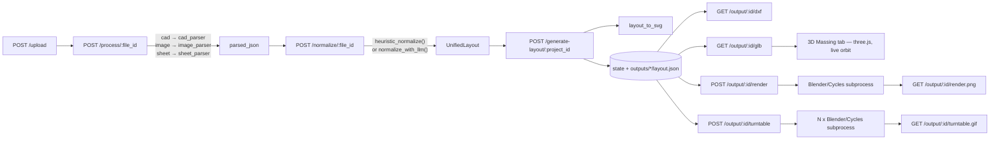

# PlanForge AI — Architecture

Technical reference for the whole system: what it does, how data moves through it,
every service module, the design decisions that aren't obvious from the code alone,
and the state of each subsystem as of this document. Complements `README.md` (which
is the getting-started guide); this file is the deep reference.

Branch: `feature/phase1-3d-massing`. Repo root: `code/planforge_ai/` inside the
`planforge` project.

---

## 1. What this is

PlanForge AI turns retail store planning documents — a BOQ spreadsheet, a scanned
floor-plan image, a DXF CAD file, or a design-proposal PDF — into a normalized 2D/3D
digital model of the store: vector plan (SVG), civil-grade drawing (DXF), a 3D massing
model (GLB, viewable in-browser), and increasingly, a photoreal render.

It was built against one real reference: a retail store design proposal supplied by
the client (a PDF kept outside this repo). That PDF's own pages define the tiers this
project targets:

| Tier | What | Status |
|---|---|---|
| — | 2D layout, zone labels, area schedule | Shipped (SVG/DXF) |
| A/A+ | "Plan View" doll's-house axonometric, flat-shaded, interactive | Shipped (3D Massing tab) |
| B | Populated with real fixture/product geometry | Partially shipped — procedural + one free CC0 asset; real client assets still blocked |
| C | Photoreal eye-level renders, 5 named views, branded creative | Partially shipped — Blender/Cycles pipeline built; branded content blocked on the client |

The guiding rule across every stage: **make placeholder data more honest, not force
a visual outcome.** Every assumption the system makes is resolved through an explicit,
auditable ladder (§5) and surfaced to the caller — never silently guessed.

---

## 2. Tech stack

| Layer | Choice |
|---|---|
| API | FastAPI (Python), Uvicorn |
| Data model | Pydantic (`UnifiedLayout`) |
| 2D parsing | `pdfplumber`, `pandas` (sheets), `opencv-python` + `pytesseract` (images), `ezdxf` (CAD) |
| 2D geometry / SVG | `shapely`, `svgwrite` |
| DXF export | `ezdxf` |
| 3D geometry | `trimesh`, `numpy`, `shapely` (for band cross-sections), `Pillow` (textures) |
| LLM normalization (optional) | Ollama (local), or any OpenAI-compatible HTTP API (OpenAI, Gemini) |
| Photoreal rendering | Blender 4.2 LTS + Cycles, invoked as a subprocess (GPL — never linked into the app) |
| Frontend | Vanilla JS + Jinja2 templates, three.js (3D Massing viewer, dynamic import), a hand-rolled DXF canvas viewer |
| Tests | `pytest`, no browser/GUI test runner — headless Chrome via CDP used ad hoc during development for visual verification, not part of the CI suite |

No ORM, no database — state is an in-memory Python registry (`app/state.py`) with a
disk-fallback path for layouts (`outputs/{project_id}/layout.json`) so output routes
survive a server restart.

---

## 3. High-level pipeline



Every stage consumes the **same** `UnifiedLayout` — `geometry_engine` (SVG),
`dxf_exporter` (DXF), and `mesh_builder` (3D/photoreal) are peers, not a chain. None
of them mutate upstream data; all of them resolve their own missing values through
the shared resolution ladder.

---

## 4. Directory structure

```
app/
  main.py                    FastAPI app factory, CORS, static mount, routers
  state.py                   in-memory project/file/layout registry (UUID keyed)
  api/
    routes_upload.py         POST /upload
    routes_process.py        POST /process/:file_id, POST /normalize/:file_id
    routes_output.py         layout/SVG/DXF/GLB/massing-meta/render/turntable routes
    routes_settings.py       runtime LLM provider config (GET/POST /api/llm-config)
  core/
    config.py                pydantic-settings Settings (.env-backed)
    llm_client.py             heuristic + LLM normalization, provider dispatch
  models/
    layout_schema.py         UnifiedLayout, WallSegment, Room, Fixture, Opening
  services/
    sheet_parser.py          PDF/Excel/CSV -> parsed_json           (1767 lines)
    image_parser.py          floor-plan image -> parsed_json         (98 lines)
    cad_parser.py             DXF -> parsed_json                      (105 lines)
    image_processing_utils.py  Hough line merge, contour room detect  (216 lines)
    layout_llm_guard.py       structural gates on LLM output          (216 lines)
    layout_engine.py          pipeline glue: parse/normalize/generate  (88 lines)
    resolution.py             the assumption ladder (shared)          (232 lines)
    geometry_engine.py        UnifiedLayout -> SVG                    (1171 lines)
    dxf_exporter.py           UnifiedLayout -> civil-grade DXF        (991 lines)
    fixture_types.py          retail fixture taxonomy + band recipes  (612 lines)
    asset_loader.py           authored GLB assets: load/fit/place     (264 lines)
    mesh_builder.py           UnifiedLayout -> GLB (Tier A/A+)        (1926 lines)
    photoreal.py              Blender subprocess orchestration        (694 lines)
  blender/
    render_scene.py           runs INSIDE Blender's own Python only — never imported
  assets/
    fixtures/                 authored GLB assets + manifest.json (CC0 provenance)
    textures/                 floor/wall PBR textures + manifest.json
  static/
    css/studio.css
    js/massing-viewer.js      three.js 3D Massing + Photoreal Still/Turntable UI
    js/dxf-parser.js          hand-rolled DXF canvas viewer
    hdri/                     CC0 HDRI for both the browser viewer and Blender
  templates/
    studio.html               the whole frontend (single Jinja2 template)
  utils/
    file_handler.py           upload/output disk IO
    output_disk.py            disk-fallback reads after a restart
    validators.py              layout validation (closed polygons, scale sanity)
scripts/
  run_pipeline.sh             end-to-end CLI client
  setup_blender.sh            portable Blender install, no root, ~1.3GB (gitignored)
  test_cad_to_2d.sh
tests/                        264 tests, pytest, no browser runner
```

---

## 5. The resolution ladder (`app/services/resolution.py`)

`UnifiedLayout` deliberately carries no Z data, no ceiling height, no wall thickness,
and fixture height/elevation are often absent from source data. Every value the
pipeline needs but the layout doesn't carry is resolved through **one fixed
precedence**, recorded, never silently guessed:

| Rank | Source | Origin | Confidence |
|---|---|---|---|
| 1 | `user_supplied` | `layout.meta[<field>]` override | 1.00 |
| 2 | `parsed` | present in the normalized JSON | 0.90 |
| 3 | `derived` | computed from other known values | 0.70 |
| 4 | `type_default` | per-fixture-type table (`fixture_types.py`) | 0.40 |
| 5 | `global_default` | `app/core/config.py` | 0.20 |

Invariants:
- **Deterministic** — same input, same resolutions, same GLB vertex hash (→ stable ETag).
- **Total** — every governed field always resolves; `global_default` is the floor.
- **Honest** — `model_confidence` is the **minimum** across all resolutions, not the
  mean. One assumed ceiling height invalidates the model's Z axis however well
  everything else resolved.
- A single **blind** (rank 5) default sets `not_for_construction = true`. Rank 4 is an
  *informed* default (the fixture's own type supplied it) and only lowers confidence —
  otherwise every model ever built would carry the badge and it would stop meaning
  anything.
- **Overridable** — rank 1 always wins, so correcting a value is a `meta` edit, not a
  code change.

Every resolver follows the same shape and returns `(value, source)`, logging a
`Resolution(field, value, source, rule_id, subject)` into a `ResolutionLog`. Rule IDs
(`R-CEIL-01`, `R-FXT-04`, `R-FIT-05`, …) are stable identifiers so an audit can cite
exactly which rule produced a value. Resolvers used across the codebase:

| Function | Where | Governs |
|---|---|---|
| `resolve_ceiling_height_mm` | `mesh_builder.py` | ceiling height |
| `resolve_wall_thickness_mm` | `mesh_builder.py` | wall thickness |
| `resolve_fixture_height_mm` | `mesh_builder.py` | per-fixture height |
| `resolve_fixture_elevation_mm` | `mesh_builder.py` | per-fixture underside height above floor |
| `resolve_fixture_type` | `fixture_types.py` | which band recipe applies |
| `fit_asset` | `asset_loader.py` | whether an authored mesh may replace a recipe |

`GET /output/{id}/massing-meta` serves the full `resolutions` list plus a `summary()`
(`model_confidence`, `has_blind_defaults`, `blind_fields`, `weakest`) so the frontend
can badge an assumption-heavy model without re-deriving anything.

---

## 6. Data model (`app/models/layout_schema.py`)

```python
class UnifiedLayout(BaseModel):
    units: str = "mm"
    walls: list[WallSegment]      # bare centrelines — x1,y1,x2,y2
    rooms: list[Room]             # name, area, polygon
    fixtures: list[Fixture]       # kind, x, y, label, width_mm, depth_mm, height_mm, rotation_deg
    openings: list[Opening]       # kind (door/window/opening), x1,y1,x2,y2, label
    meta: dict[str, Any]          # per-layout overrides — the only "rank 1" input surface
```

Deliberately minimal. No SKU, no ID, no category enum on `Fixture` beyond the free-text
`kind`/`label` pair — identity is recovered downstream by `fixture_types.resolve_
fixture_type`, not carried in the schema. `meta` is the escape hatch for every
resolver above (`ceiling_height_mm`, `wall_thickness_mm`, `fixture_elevations_mm`, …).

**Two distinct key spaces reach this schema**, and every consumer that identifies a
fixture type has to handle both:

| Path | `kind` | `label` |
|---|---|---|
| BOQ workbook | item code, e.g. `"13-A"` | same item code (label == kind) |
| Plan PDF/CSV | category, e.g. `"display"` | description, e.g. `'65" Smart Signage'` |

---

## 7. Ingest: parsers (`app/services/*_parser.py`)

Three independent parsers, selected by the `type` form field on `POST /upload`
(`cad` \| `image` \| `sheet`). Each returns an arbitrary `parsed_json` dict — there is
no shared parser interface beyond "produces something `normalize_with_llm`/
`heuristic_normalize` can read."

- **`sheet_parser.py`** (1767 lines, by far the largest parser) — PDF/Excel/CSV BOQ and
  plan-table ingestion. Handles multiple sheet-routing conventions, a `Fixture_schedule`
  table with `model_ref` columns, vendor dimension tables
  (`meta.fixture_vendor_tables`), and a shelf-packing auto-layout for BOQ rows that
  carry no coordinates at all (a BOQ is a schedule, not a plan — position is invented,
  not lost).
- **`image_parser.py`** — Hough-transform wall detection + Phase 2 contour-based room
  detection (`image_processing_utils.py`) + Tesseract OCR for labels.
- **`cad_parser.py`** — `ezdxf`-based: `LINE`/`LWPOLYLINE` entities as walls, `TEXT`/
  `MTEXT` as labels, `DIMENSION` entities where present.

---

## 8. Normalization (`app/core/llm_client.py`)

Converts `parsed_json` into a `UnifiedLayout`. Three modes, selected per-project at
runtime via `POST /api/llm-config` (`app/api/routes_settings.py`) or by
`.env`/`PLANFORGE_SHEET_NORMALIZE_MODE`:

| Mode | What runs |
|---|---|
| `heuristic_only` (default) | `heuristic_normalize()` — deterministic Python, no network call |
| `llm_labels_only` | Heuristic baseline + LLM asked only to improve room/opening/fixture *labels* and non-geometric `meta` patches — geometry is never touched |
| `llm_merge` | LLM asked to return the full layout; every wall endpoint, room vertex, fixture position and opening segment from the heuristic baseline must survive **exactly** (same numeric values) — the LLM may only adjust strings |

Providers: Ollama (local, temperature 0 for determinism), or any OpenAI-compatible
HTTP endpoint (OpenAI, Gemini). Every LLM call is optional — the pipeline runs
end-to-end with `provider: "none"` using heuristics alone.

**`layout_llm_guard.py`** is the safety net for the geometry-preserving modes: it
structurally compares the LLM's candidate layout against the heuristic baseline and
rejects the candidate (falling back to heuristic) if:
- wall count drops more than 15%,
- bounding-box area shrinks more than 30%,
- bounding-box diagonal shrinks more than 30%, or
- any matched room's centroid drifts more than 20% of the baseline diagonal.

An LLM cannot silently delete or relocate geometry; it can only be rejected wholesale
and fall back to the deterministic baseline.

---

## 9. 2D outputs

### 9.1 `geometry_engine.py` — SVG
`layout_to_svg()` renders the vector plan: room fills from a fixed muted palette,
fixture outlines (with a type-aware color heuristic, `_fixture_palette`), dimension
lines, an optional underlay image (for image-sourced layouts) and an optional
reference-plan overlay (`PLANFORGE_REFERENCE_PLAN_IMAGE`). `normalize_to_origin()` and
`light_snap_walls()` run before rendering to clean up parser noise.

### 9.2 `dxf_exporter.py` — civil-grade DXF
Full IS/ISO-layer-convention drawing: `WALLS`/`ROOMS`/`FIXTURES`/`OPENINGS`/
`DIMENSIONS`/`ANNOTATIONS`/`TITLEBLOCK`/`SCALEBAR`, a custom `PLANFORGE_DIM`
dimension style, per-fixture linear dimensions, overall + partition-to-partition
dimension chains, **A–D elevation markers** (the same named-viewpoint convention the
3D viewer's `build_viewpoints()` reuses), a fixture BOM table, title block, scale bar
and north arrow. This is the file that goes to a CAD-literate audience; SVG is the
browser preview.

---

## 10. 3D massing (`app/services/mesh_builder.py`, "Tier A/A+")

The largest single module (1926 lines). Builds a `trimesh.Scene` directly from
`UnifiedLayout` — no intermediate format, no persistence (**regenerated on every
request**; a GLB is never written to disk by the `/glb` route, deliberately — see
§10.6).

### 10.1 Coordinate system
Layout X/Y copied verbatim; Z is the only added axis. The scene is **Z-up in layout
millimetres**, matching the 2D plan and the DXF exporter exactly — this is what makes
"3D bbox equals 2D bounds" a literal, testable invariant. glTF is Y-up, so the
Z-up→Y-up rotation is applied once, on the `PLANFORGE_ROOT` group node — geometry
itself is never rewritten to a different axis convention.

### 10.2 Geometry primitives
| Function | Produces |
|---|---|
| `_box` | plain axis-aligned box |
| `_rounded_box` | box with radiused vertical corners (`shapely` buffer + `extrude_polygon`) |
| `_bevelled_top_box` | box with a chamfered top edge — a hand-wound 8-vertex/12-triangle frustum (not `trimesh.convex_hull`, which needs `scipy`, not a project dependency) |
| `_place_prop_in_cell` | places a **shared authored asset** (not a procedural primitive) into one repeat-grid cell |

Openings (doors/windows) are cut via **sub-rectangle decomposition** (jamb/lintel/sill
boxes), not boolean subtraction — watertight by construction, and a zero-width jamb
degrades to nothing instead of a degenerate boolean operand.

`engine="earcut"` is passed explicitly at every `extrude_polygon` call — `trimesh`
would otherwise be free to select the `triangle` package, which is not licensed for
commercial use.

### 10.3 The fixture taxonomy & band recipe system (`fixture_types.py`)

The core idea: a wall bay, a cash counter and a display panel being the same grey box
is dimensionally correct and visually useless. Sixteen company-neutral fixture types
(no vendor branding — vendor item codes/descriptions map *into* this taxonomy, never
the reverse), each a `FixtureType` with a tuple of `Band`s — fractional-height
horizontal slices, each with its own material, inset, and (increasingly) its own
geometric detail:

```python
@dataclass(frozen=True)
class Band:
    name: str
    z0: float; z1: float              # fraction of the fixture's own declared height
    material: str = MAT_BODY
    inset_w: float = 0.0; inset_d: float = 0.0
    back: bool = False                # anchor toward the rear of the footprint
    project_d: float = 0.0            # POC-only: grow forward, clamped to poc_envelope_d
    repeat_w: int = 1; repeat_d: int = 1   # grid of copies (product on a shelf/table)
    corner_r: float = 0.0             # radiused corners, fraction of shorter side
    bevel_mm: float = 0.0             # chamfered top edge, mm
    recess_mm: float = 0.0            # set back behind a neighbour, mm (glass in a bezel)
    asset_key: str | None = None      # place a shared authored mesh instead of a box
    asset_target_mm: float = 140.0
    asset_lay_flat: bool = False
```

**Invariant that never softens across every one of these fields:** a band may only
ever *shrink* its width, or grow depth forward within the type's explicit
`poc_envelope_d` — nothing a recipe declares can push the model's rendered footprint
past the layout's own declared bounds. `test_fixture_bands_never_exceed_declared_
dimensions` and `test_every_band_fits_inside_the_footprint` pin this generically,
across every fixture type, not per-recipe.

**Two fixture types resolve to a real authored asset instead of a band stack**
(`needs_asset=True`, see §11): `chair`, `stool`. `pillar` also uses one.

**Sixteen types**, resolved from the two key spaces (§6) via `resolve_fixture_type`
(item code → description keyword → `kind` keyword → dimensional heuristic → fallback,
first match wins, order documented in `_MATCH_ORDER`):

| Type | Bands (name: z-range) | Notable geometry |
|---|---|---|
| `base_cabinet` | kick, body, drawer, drawer_upper, handle_lower, handle_upper, top | Beveled worktop, shadow-groove handles |
| `wall_bay` | base, panel, shelf_1-4, stock_1-4, boxing | Shelves project forward (`project_d`); stock bands place the real phone asset; `poc_envelope_d=3.0` |
| `display_panel` | frame, face | Recessed glass face |
| `island_table` | plinth, top, mat, device | Beveled top; device band places the real phone asset, laid flat |
| `counter` | body, top | Beveled top |
| `service_desk` | plinth, body, front, top, screen | Recessed screen |
| `shelf_unit` | back, plinth, shelf_1-3, stock_1-3 | Stock boxes as a repeat grid |
| `screen_wall` | frame, screen | Deep recess (biggest glass face in the taxonomy) |
| `boxing` | body | Beveled top edge (bulkhead cap) |
| `signage_panel` | face | Solid box |
| `light_box` | frame, face | `MAT_EMISSIVE` — glows without any texture work |
| `pillar` | body | **Authored asset** (Poly Pizza column, CC0) |
| `partition` | body | Solid box |
| `chair` | legs, seat, back | **Authored asset** (Poly Haven school chair, CC0), `height_means="seat"` |
| `stool` | legs, seat | **Authored asset** (Poly Haven bar chair, CC0), `height_means="seat"` |
| `generic_box` | body | Fallback for anything unresolved |

Material keys (`MAT_BODY`, `MAT_TOP`, `MAT_PANEL`, `MAT_BOXING`, `MAT_SCREEN`,
`MAT_ACCENT`, `MAT_GENERIC`, `MAT_EMISSIVE`) resolve to flat/textured colors in
`mesh_builder`'s palette, sampled from the reference proposal's own renders rather
than picked freehand (oak floor, near-black cabinetry — see `_PALETTE`'s own comment).

### 10.4 Wall-bay run merging
Adjacent `wall_bay`/`base_cabinet` fixtures on the same wall line, within 150mm of
each other, render as one visually continuous run instead of separate boxes with a
seam — matching how the reference proposal's shelving reads. Click-to-SKU identity
is preserved: only the *rendered* footprint extends to close the gap; `extras["width_
mm"]` and everything derived from the declared size stay the fixture's true value.

### 10.5 Materials & textures
Flat neutral palette by default; **floor and wall** carry real tileable CC0 PBR
textures (color + packed ORM + normal map — see `app/assets/textures/manifest.json`
for full provenance). No other surface is textured — a 100mm-deep fixture band shows
too little of a tile to be worth the payload. Textures are re-encoded through a
`BytesIO` round-trip specifically because `trimesh` picks the embedded image format
from `Image.format`, which any processed image silently loses (defaulting to PNG —
~10x larger than the JPEG it should be).

### 10.6 Provenance, determinism, and the "never persist" rule
`MassingResult.vertex_hash()` is a stable SHA-256 over every mesh's sorted name +
vertices + faces — identical input always yields an identical hash, which is what
lets `GET /output/{id}/glb` regenerate on every request (no server-side GLB cache)
while still emitting a correct `ETag`. `MassingResult.provenance` carries `z_source`,
`fixtures_typed`/`fixtures_untyped`, `fixture_type_counts`, and
`poc_depth_projection` (which fixtures used the `project_d` allowance and by how
much) — every assumption this module makes is visible in the API response, not just
in code comments.

### 10.7 Viewpoints (`build_viewpoints`, `turntable_viewpoints`)
`build_viewpoints()` returns the **PLAN** view (entrance-facing if an entrance opening
is identifiable, else a corner axonometric) plus four named elevations **A–D**,
reusing the exact same convention the DXF exporter's own elevation markers draw —
2D and 3D "view B" mean the same thing. `turntable_viewpoints(layout, ceiling_mm,
n_frames)` generates N cameras evenly spaced around one full circle at constant
height/radius, used only by the photoreal turntable (§11.3), not by the live viewer.

---

## 11. Authored assets (`app/services/asset_loader.py`)

Parametric band recipes get a fixture's *dimensions* right but its *form* wrong — a
chair is not a stack of boxes. Where a real CC0 mesh exists, this module supplies it;
where one doesn't, or where using it would distort the fixture, the caller falls back
to the band recipe.

**Normalisation** — every asset declares `native_units`/`native_up_axis` in
`manifest.json` and is converted on load to millimetres, Z-up, footprint centred on
the origin, underside at z=0.

**Fitting — the refuse-rather-than-distort ladder** (`fit_asset`): height drives the
scale (the dimension sources most reliably carry — a BOQ often gives seating as
`— × — × 600`, height only). A uniform scale that passes the height check can still
badly distort the footprint (a shelf authored narrow-and-deep, scaled to the right
height, stays narrow-and-deep), so the resulting footprint is checked too. Returns
`None` — not a distorted mesh — when the fit would exceed `_UNIFORM_LIMIT` (35%) on
either height or the resulting footprint. **A correct parametric box beats a badly
proportioned mesh**: a wrong size reads as schematic; a distorted object reads as
broken.

| Fit method | Rule ID | Meaning |
|---|---|---|
| `exact` | R-FIT-01 | declared size == authored size (within 1%) |
| `tiled` / `tiled_filler` / `nine_slice` | R-FIT-02/03/04 | **not yet implemented** — needs modular assets this project doesn't have |
| `uniform_scale` | R-FIT-05 | uniform scale within the 35% tolerance |
| `rejected` (`None` returned) | R-FIT-06 | would distort; caller uses the band recipe |

**Provenance** — every manifest entry ships licence, source URL, author, and
modifications; CC0 is required (an attribution obligation discovered inside a client
proposal is expensive). Textures are **stripped by policy** on every asset except one
deliberate, documented exception (§11.1) — geometry is what a recipe cannot supply; a
source asset's own finish is neither neutral nor appropriate to a retail interior.

### 11.1 The assets currently shipped

| Key | Source | Licence | Note |
|---|---|---|---|
| `chair` | Poly Haven — School Chair 01 | CC0-1.0 | Decimated to ~3000 tris, textures stripped |
| `stool` | Poly Haven — Bar Chair Round 01 | CC0-1.0 | Decimated to ~3000 tris, textures stripped |
| `pillar` | Poly Pizza (Kenney) — Column Thin | CC0-1.0 | 44 tris; a same-search Quaternius candidate was rejected on visual inspection (ornate fluted column, wrong for a modern retail interior) despite matching licence/dimensions |
| `product_phone_generic` | OpenGameArt — "Smartphone" by Brian MacIntosh | CC0-1.0 | **The one texture exception** — see below |

**`product_phone_generic`** is placed per-cell by `mesh_builder._place_prop_in_cell`
(not through `fit_asset`'s whole-fixture ladder — there's no declared size for "one
phone on a shelf" to refuse against). It's the deliberate exception to the
"textures stripped" rule: its entire identifying read (screen, camera dot, nav
buttons) is a photographed texture, not geometry — stripping it would leave a plain
rounded slab, exactly what the procedural placeholder already builds, making the
whole point of using a real asset moot. The source had already de-branded the model
(removed the original trademarked logo, "redacted" in its own shipped filename)
before this project found it. Every placed copy shares one Python material/image
object (`trimesh` does not instance geometry — `EXT_mesh_gpu_instancing` is an open
upstream issue — so sharing the material is what keeps a 16-phone shelf from
embedding its 20KB texture sixteen times over).

### 11.2 A real, measured Cycles rendering bug (worth knowing about)

During the phone-asset integration, every placed phone rendered **invisible** — not
dim, not wrong-colored, absent from the frame — in the full `wall_bay` scene, despite
every unit test passing (the geometry was correct throughout; only Cycles' rendering
of it was wrong). Root-caused with 8+ controlled test renders, ruling out camera
angle, Y-clearance (up to 130mm), `alphaMode`, `doubleSided`, watertightness, and
material count/index in turn. Confirmed cause: **a placed asset renders invisible
when its bounding box sits 2-or-more-axis-contained inside a much larger opaque
band's bounding box** — here, `wall_bay`'s old full-height "panel" backdrop at
roughly 15–70x the phone's own size. Procedural bands are unaffected (`shelf_1`–`4`
overlapped that same backdrop constantly and always rendered fine). Fixed by
shortening `panel` to end below the first product band; pinned by
`test_no_large_band_shares_a_z_range_with_a_placed_asset_band`, which checks the
invariant across **every** fixture type, not just `wall_bay`.

---

## 12. Photoreal render pipeline ("Stage 2")

### 12.1 Why a subprocess boundary
Blender is GPL-licensed and ~1GB installed. `app/services/photoreal.py` is pure
Python and safe to import anywhere — it never imports `bpy`. `app/blender/
render_scene.py` runs **only** inside Blender's own bundled Python, invoked via
`blender --background --python render_scene.py -- <args>`. This is the boundary
`ARCH-POC/verify.md` itself calls for ("run as a subprocess, never linked").

### 12.2 What `render_scene.py` does
1. Import the GLB `mesh_builder` already produces — same geometry, same materials.
2. Delete the `ceiling` group, mirroring the browser viewer's own default-hidden group.
3. Rescale the `PLANFORGE_ROOT` hierarchy by 0.001 — **mesh_builder ships raw
   millimetre numbers as glTF unit values, and glTF's spec says one unit is one
   metre**, so an unscaled import would make a 6m room 6km wide. (A real bug caught
   during Stage 2 development: the first pass silently rendered nothing because of
   this — the depsgraph also needs an explicit `view_layer.update()` after setting
   `.scale`, since child `matrix_world` values are stale until then.)
4. Build the World shader graph from the same CC0 HDRI the browser viewer uses
   (`app/static/hdri/phone_shop_1k.hdr`, Poly Haven), split via a `Light Path → Is
   Camera Ray → Mix Shader` so the HDRI lights and reflects the scene but a direct
   camera ray sees the flat page background instead — matching the viewer's own
   `scene.background` (flat) vs `scene.environment` (HDRI) split, not the raw photo.
5. Place the camera at the eye/target `mesh_builder` already computed for the
   requested named viewpoint (§10.7) — same framing the browser tab shows.
6. One generic sun as the key light — a **stated assumption**, not real data: there
   is no reflected ceiling plan in any input this pipeline has, so there is no real
   downlight grid to place.
7. Cycles, CPU device, denoised (OpenImageDenoise), render, write PNG.

### 12.3 Orchestration (`app/services/photoreal.py`)
In-memory job tracking (`_Job`/`_TurntableJob` dataclasses, a lock, two registries) —
a real, documented limitation for a local single-user POC: state is lost on a server
restart mid-render, and it doesn't scale past one worker. `get_status`/`get_
turntable_status` fall back to checking the output file on disk, so a restart at
worst forgets an *in-flight* render, not a finished one (a small JSON sidecar next to
each output carries enough metadata — `viewpoint_id`, `samples`, frame count — to
answer status correctly after that fallback).

**Single still**: `POST /output/{id}/render?viewpoint_id=B` → poll `GET .../render/
status` (`running`/`done`/`error`, elapsed time) → `GET .../render.png`. Builds the
GLB itself on each call (same `build_massing` the `/glb` route uses), so a render
always reflects the current layout. Falls back to the "PLAN" viewpoint for a missing
or unrecognised `viewpoint_id`.

**Turntable**: `POST /output/{id}/turntable` → poll `GET .../turntable/status`
(`frames_done`/`frames_total`) → `GET .../turntable.gif`. One Blender subprocess **per
frame** (simpler and safer than keeping one Blender process warm across frames, at a
negligible ~0.2s/frame startup cost) using `turntable_viewpoints()`. Frames are
stitched into an animated GIF with Pillow — no `ffmpeg` dependency, and `` autoplays/loops in any browser with zero JS. `POST .../turntable/cancel`
sets a flag checked between frames **and kills the in-flight subprocess** — a 5+
minute job needs a real cancel, not just "stop queuing more work."

### 12.4 Why this exists instead of a live orbit
Path tracing computes real light bounces per pixel; on this project's CPU-only
development machine (no discrete GPU) that's tens of seconds per frame, not a
per-frame cost an orbit control can pay 60 times a second. **There is no hardware
path to both live and photoreal at once on this machine** — 3D Massing trades
photoreal lighting for real-time orbiting; Photoreal (still or turntable) trades
interactivity for real light transport. The turntable is the closest real substitute
for "orbit the photoreal model": a fixed lap, pre-rendered once, played back as a
loop — not something you can steer mid-render.

### 12.5 Measured performance (this project's dev hardware: 8-thread CPU, no GPU)
| | Setting | Time |
|---|---|---|
| Single still | 128 samples, 1280×720 | ~40–65s |
| Turntable frame | 48 samples, 960×540 | ~13–17s/frame |
| Turntable (24 frames) | — | ~5–7 minutes total |

A GPU (the client reportedly has an A100 that may be usable off-hours, per
`ARCH-POC/verify.md`) would cut these substantially, but was never available during
development — every number above is measured, not estimated.

---

## 13. Frontend (`app/templates/studio.html`, ~1700 lines, single Jinja2 template)

One page, four result tabs, each importing its own dependency lazily:

| Tab | Backing | Notes |
|---|---|---|
| Diagram | Raw SVG from `/output/{id}/svg`, inlined | No JS library |
| DXF View | `app/static/js/dxf-parser.js` | Hand-rolled canvas DXF viewer, pan/zoom/layers |
| 3D Massing | `app/static/js/massing-viewer.js` | three.js, dynamic `import()` on first open so users who never leave 2D never download it. `OrbitControls`, click-to-SKU, viewpoint dropdown (same PLAN/A–D list DXF markers draw), dimension labels, group visibility toggles (walls/fixtures/ceiling/floor) |
| Photoreal | Same file, **Still** and **Turntable** sub-tabs | No 3D library at all — the browser only ever fetches a PNG or GIF. Still: viewpoint picker, Generate, poll status, download. Turntable: Generate, live frame-progress text, Cancel, download |

`massing-viewer.js` also handles graceful degradation: WebGL availability is
feature-detected (Chrome dropped the SwiftShader CPU fallback, so a locked-down or
VDI machine can fail context creation outright), and a render-path self-test degrades
ambient occlusion / shadows one feature at a time by comparing rendered luma against
a known-good baseline — some software/driver combinations report success and then
silently return a black frame.

---

## 14. Testing (`tests/`, 264 tests collected, pytest)

No browser or GPU dependency in the suite itself — every 3D/render test operates on
`trimesh` geometry or mocked subprocess calls. Real visual correctness (does it
actually *look* right) was verified separately throughout development via headless
Chrome (CDP) for the browser UI and real Blender renders for the photoreal pipeline —
**deliberately not automated into CI**, because the lesson learned repeatedly this
session is that geometry can be 100% unit-test-correct and still render wrong (see
§11.2); a human look at a real render is not something these tests claim to replace.

| File | Tests | Covers |
|---|---|---|
| `test_mesh_builder.py` | 109 | Band geometry, watertightness, determinism, materials/textures, viewpoints, placed-asset mechanism, the Cycles-bug regression guard |
| `test_photoreal.py` | 23 | Job orchestration, viewpoint fallback, turntable frame progress/cancel, GIF stitching — subprocess and thread fully mocked |
| `test_asset_loader.py` | 30 | Manifest provenance/licence, normalisation, the refuse-rather-than-distort ladder |
| `test_fixture_types.py` | 30 | Type resolution precedence, keyword/item-code matching, recipe completeness |
| `test_resolution.py` | 14 | The ladder itself — rank ordering, `model_confidence`, blind-default detection |
| `test_schema_validation.py` | 5 | `UnifiedLayout` validation |
| `test_layout_llm_guard.py` | 4 | Structural gate rejection thresholds |
| `test_llm_normalize_modes.py` | 2 | Mode selection |
| `test_image_processing_utils.py` | 2 | Hough merge / contour helpers |
| `test_sheet_csv.py` | 3 | Sheet parsing — **1 pre-existing unrelated failure**, see below |

`test_sheet_csv.py::test_xlsx_still_parses` fails on this branch **and** on
`origin/feature/poc` — a pre-existing, unrelated issue (`sheet_bundle_format` reads
`"boq_excel"` where the test expects `"excel"`), not introduced by any work described
in this document. Every other test passes.

Notable structural test patterns worth reusing:
- **Generic, cross-cutting invariants** rather than one-off pins where possible — e.g.
  `test_no_large_band_shares_a_z_range_with_a_placed_asset_band` checks every fixture
  type, not just the one that triggered it.
- **Fallback paths are always tested by monkeypatching the failure**, not by deleting
  the real asset (`monkeypatch.setattr(asset_loader, "load_asset", lambda key: None)`).
- **Determinism is pinned directly** (`vertex_hash()` equality across two builds of
  the same layout), not inferred from "looks stable."

---

## 15. Configuration reference (`app/core/config.py`, `.env`)

| Variable | Default | Governs |
|---|---|---|
| `UPLOAD_DIR` / `OUTPUT_DIR` | `uploads` / `outputs` | Disk locations |
| `OLLAMA_HOST` / `OLLAMA_MODEL` | — | Local LLM normalization |
| `LLM_API_URL` / `LLM_API_KEY` / `LLM_MODEL` | — | Any OpenAI-compatible HTTP provider |
| `OPENAI_API_KEY` / `OPENAI_MODEL` | — | OpenAI specifically |
| `GEMINI_API_KEY` / `GEMINI_MODEL` | — | Gemini specifically |
| `TESSERACT_CMD` | — | OCR binary path override |
| `PLANFORGE_SHEET_NORMALIZE_MODE` | `heuristic_only` | `heuristic_only` \| `llm_merge` \| `llm_labels_only` |
| `PLANFORGE_REFERENCE_PLAN_IMAGE` | — | Faint reference overlay on the SVG |
| `MESH_CEILING_HEIGHT_MM` | `3000.0` | Global-default ceiling height (rank 5) |
| `MESH_WALL_THICKNESS_MM` | `100.0` | Global-default wall thickness (rank 5) |
| `BLENDER_BIN` | unset → `.tools/blender/blender` | Portable Blender binary path |
| `PHOTOREAL_SAMPLES` / `_WIDTH` / `_HEIGHT` | `128` / `1280` / `720` | Single-still Cycles quality |
| `PHOTOREAL_TIMEOUT_SECONDS` | `900.0` | Single-still hard timeout |
| `PHOTOREAL_TURNTABLE_FRAMES` / `_SAMPLES` / `_WIDTH` / `_HEIGHT` | `24` / `48` / `960` / `540` | Turntable quality/frame count |
| `PHOTOREAL_TURNTABLE_FRAME_TIMEOUT_SECONDS` | `300.0` | Per-frame hard timeout |

`BLENDER_BIN` unset and no portable install present → the Photoreal routes 503 with a
clear message rather than the app failing to start; every other route is unaffected.

---

## 16. Known limitations & open blockers

These are not bugs — they're explicit, stated gaps, most of them waiting on the
client, not on more engineering:

1. **Real product/fixture models.** Everything on a shelf/table/wall is either a
   parametric band recipe or one generic, de-branded CC0 phone. No client-owned
   geometry exists in this pipeline, deliberately.
2. **Branded creative.** Screen content, packaging graphics, logos — not
   fabricatable without rights, and out of scope to attempt.
3. **The real BOQ.** The sample BOQ this project validated against is for a
   *different store* (661 sq ft) than the
   reference design proposal (~979–1163 sq ft) — nothing has been
   validated end-to-end against a matched BOQ+plan pair for the same store.
4. **Real ceiling/lighting data.** No input source carries downlight positions; the
   photoreal lighting rig is one generic sun, stated as an assumption.
5. **GLB instancing.** `trimesh` does not emit `EXT_mesh_gpu_instancing` (open
   upstream issue #1151) — every repeated fixture/prop is a full geometry
   duplicate, not an instance. Guarded by
   `test_glb_stays_small_for_a_typical_two_hundred_fixture_store`; the fix when it
   stops being acceptable is a `gltf-transform` post-process, not yet built.
6. **In-memory state.** No database, no persistence beyond the layout-JSON disk
   fallback and the render-job JSON sidecars. A server restart loses everything
   except the last generated layout/render per project.
7. **Photoreal job tracking doesn't scale past one worker** — a deliberate,
   documented tradeoff for a local single-user POC (Celery/RQ + Redis is future
   work, not a Stage 2 prerequisite; see `ARCH-POC/verify.md`).
8. **Curved walls, section planes, measurement tools, first-person walk mode** —
   explicitly out of scope for this phase.

---

## 17. Project history (stage-by-stage)

Built incrementally on `feature/phase1-3d-massing`, each stage shipped, tested, and
(from Stage 1 onward) **visually verified with a real render before being called
done** — the recurring lesson of this project is that a passing test suite is
necessary but not sufficient for "it looks right."

| Stage | What shipped |
|---|---|
| Phase 1 (prior work) | 2D pipeline (parse/normalize/SVG/DXF), Tier A massing (grey boxes, correct dimensions, GLB on demand) |
| Placeholder-honesty pass | Corrected pillar dimensions, reassessed wall-bay spacing — real fixes, not manufactured-to-look-right values |
| Stage 1 | Real HDRI (Poly Haven) replacing the procedural room environment; full PBR (color + ORM + normal) on floor/wall; label/camera polish |
| Deep CC0 asset search | Verified-per-item search across Poly Haven/Sketchfab/OpenGameArt/itch.io/Poly Pizza; 8 candidates rejected on visual inspection despite matching license/dimensions — "say so plainly" when nothing clears the bar, documented in rejection manifests |
| POC depth-projection decision | `project_d` + `poc_envelope_d`: the BOQ footprint stays authoritative; a band may project forward only within an explicit, documented POC envelope — not a schema change, not a production installed-envelope concept |
| Stage 2 | Blender/Cycles photoreal render pipeline — subprocess boundary, HDRI/material parity with the browser viewer, named-viewpoint reuse, measured (not estimated) performance |
| Stage 3 | Procedural geometry detail: `bevel_mm` (chamfered edges), `recess_mm` (glass sets back from its frame), shadow-gap reveals between stacked bands, handleless-cabinetry finger-pull grooves |
| Stage 4 | Generic product placeholders — the repeat-grid two-band composition (`display_panel`'s frame+face pattern, reused per grid cell) populated shelves and tables that previously rendered as empty racking |
| Photoreal viewpoint picker | Same PLAN/A–D list as 3D Massing, `?viewpoint_id=` on the render route |
| Photoreal turntable | Pre-rendered 360° lap as a looping GIF — the closest real substitute for "orbit the photoreal model" on hardware with no path to a live one |
| Free CC0 asset integration | `product_phone_generic` replaces the procedural device band; `Band.asset_key`/`_place_prop_in_cell` — a real, textured, de-branded mesh, proving the pipeline can populate a store with genuine geometry using only free assets. Found and fixed the Cycles bounding-box-containment rendering bug (§11.2) along the way |

Every stage's commit message and this document's §16 are the accurate record of what
remains open; do not treat any prior chat summary as more current than this file.

---

## 18. Where to look for what

| Question | Look here |
|---|---|
| "Why does this fixture look like a box?" | `resolve_fixture_type` (§10.3) — check if a keyword/item-code match exists; if not it fell to `generic_box` |
| "Why is this model marked not-for-construction?" | `GET /output/{id}/massing-meta` → `provenance.blind_fields` |
| "Why did my LLM-normalized layout revert to heuristic?" | `layout_llm_guard.py` — one of the four structural gates rejected it |
| "Can I add a new fixture type?" | `fixture_types.py` — add a `FixtureType` + band tuple, register in `_MATCH_ORDER` |
| "Can I place a real asset instead of a procedural band?" | `Band.asset_key` — but read §11.2 before letting its Z-range overlap a large backdrop band |
| "Why is the photoreal tab 503ing?" | `BLENDER_BIN` unset and no `.tools/blender/blender` — run `scripts/setup_blender.sh` |
| "Why doesn't the photoreal view orbit?" | §12.4 — hardware, not a missing feature |
